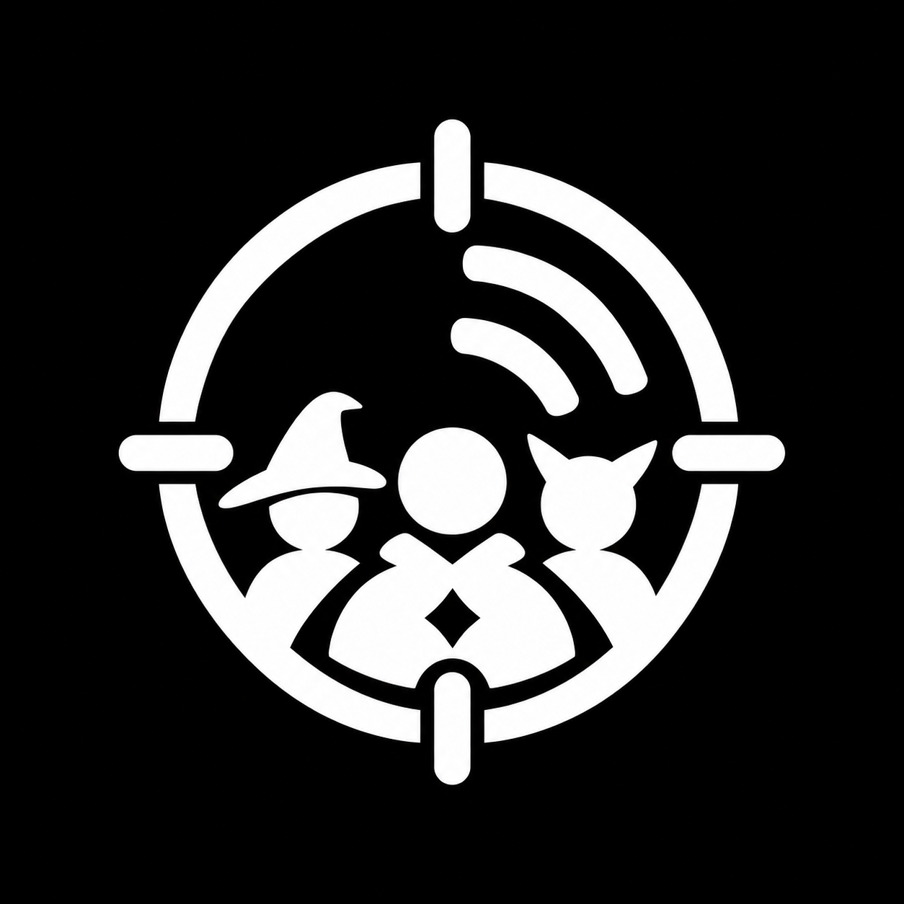

# Party Scout

Find parties that match your goals, see who's playing, and keep an eye on friends. Get alerts or opt in to automatic party switching.

## Install

1. In game, open `/xlsettings` and go to **Experimental → Custom Plugin Repositories**.
2. Add `https://raw.githubusercontent.com/Matuno/DalamudPlugins/main/repo.json` and save the settings.
3. Open the plugin installer and search for **Party Scout**.

Open Party Scout with `/partyscout` or the button beside Party Finder. Click the glyph to see matches and controls, or drag it to move your companion.

For a source build, extract `DalamudUi-source.zip` next to the Party Scout checkout and run `dotnet build -c Release`. Use the archive from the [matching release](https://github.com/Matuno/PartyScout/releases).
